# 🗄️ Database Documentation & ERD Diagram

This document contains the complete database design for the **Stadium Ticket Management Platform**, fully aligned with the requirements for the **Laboratorike 2 (2025/2026)** course.

---

## 📐 Relational Database Schema (MySQL)

The relational database consists of **24 tables** designed in **Third Normal Form (3NF)**. Every table includes proper constraints, foreign keys, indexes for query optimization, and the academic audit columns:
* `created_by` (references `users.id`)
* `updated_by` (references `users.id`)
* `created_at` (timestamp)
* `updated_at` (timestamp)

---

### 🎨 Entity-Relationship Diagram (ERD)

```mermaid
erDiagram
    users {
        int id PK
        string first_name
        string last_name
        string email UK
        string password_hash
        boolean is_active
        timestamp created_at
        timestamp updated_at
    }

    roles {
        int id PK
        string name UK
        string description
        timestamp created_at
    }

    user_roles {
        int id PK
        int user_id FK
        int role_id FK
        int created_by FK
        int updated_by FK
        timestamp created_at
        timestamp updated_at
    }

    permissions {
        int id PK
        string name UK
        string description
        string resource
        string action
        timestamp created_at
        timestamp updated_at
    }

    role_permissions {
        int id PK
        int role_id FK
        int permission_id FK
        int created_by FK
        int updated_by FK
        timestamp created_at
        timestamp updated_at
    }

    refresh_tokens {
        int id PK
        int user_id FK
        string token_hash
        timestamp expires_at
        timestamp revoked_at
        timestamp created_at
    }

    audit_logs {
        int id PK
        int user_id FK
        string action
        string entity
        int entity_id
        text old_value
        text new_value
        string ip_address
        text user_agent
        int created_by FK
        int updated_by FK
        timestamp created_at
        timestamp updated_at
    }

    notifications {
        int id PK
        int user_id FK
        string type
        string title
        text message
        boolean is_read
        timestamp read_at
        int created_by FK
        int updated_by FK
        timestamp created_at
        timestamp updated_at
    }

    settings {
        int id PK
        string key UK
        text value
        string description
        string type
        string category
        int created_by FK
        int updated_by FK
        timestamp created_at
        timestamp updated_at
    }

    files {
        int id PK
        int user_id FK
        string original_name
        string stored_name
        string file_path
        string mime_type
        int file_size
        string entity
        int entity_id
        int uploaded_by FK
        int created_by FK
        int updated_by FK
        timestamp created_at
        timestamp updated_at
    }

    stadiums {
        int id PK
        string name
        string city
        string country
        int capacity
        string address
        string image_url
        text description
        boolean is_active
        int created_by FK
        int updated_by FK
        timestamp created_at
        timestamp updated_at
    }

    sections {
        int id PK
        int stadium_id FK
        string name
        int row_count
        int seats_per_row
        float price_multiplier
        text description
        int created_by FK
        int updated_by FK
        timestamp created_at
        timestamp updated_at
    }

    matches {
        int id PK
        string home_team
        string away_team
        int stadium_id FK
        date match_date
        time match_time
        string competition
        string round
        enum status
        int home_score
        int away_score
        float base_price
        int max_tickets_per_user
        timestamp sale_start_date
        timestamp sale_end_date
        int created_by FK
        int updated_by FK
        timestamp created_at
        timestamp updated_at
    }

    tickets {
        int id PK
        int match_id FK
        int section_id FK
        int row_number
        int seat_number
        float price
        enum status
        text qr_code
        string barcode
        int purchaser_id FK
        timestamp purchased_at
        timestamp reserved_until
        int created_by FK
        int updated_by FK
        timestamp created_at
        timestamp updated_at
    }

    orders {
        int id PK
        int user_id FK
        string order_number UK
        float total_amount
        enum status
        string payment_method
        enum payment_status
        string payment_reference
        string customer_email
        string customer_phone
        text notes
        int created_by FK
        int updated_by FK
        timestamp created_at
        timestamp updated_at
    }

    order_items {
        int id PK
        int order_id FK
        int ticket_id FK
        float unit_price
        int quantity
        float subtotal
        int created_by FK
        int updated_by FK
        timestamp created_at
        timestamp updated_at
    }

    payments {
        int id PK
        int order_id FK
        float amount
        string currency
        string method
        enum status
        string transaction_id
        string gateway_reference
        text gateway_response
        timestamp paid_at
        timestamp refunded_at
        float refund_amount
        int created_by FK
        int updated_by FK
        timestamp created_at
        timestamp updated_at
    }

    reviews {
        int id PK
        int user_id FK
        int match_id FK
        int stadium_id FK
        int rating
        text comment
        boolean is_approved
        int created_by FK
        int updated_by FK
        timestamp created_at
        timestamp updated_at
    }

    coupons {
        int id PK
        string code UK
        string description
        enum discount_type
        decimal discount_value
        decimal min_order_amount
        int max_uses
        int used_count
        boolean is_active
        timestamp valid_from
        timestamp valid_until
        int created_by FK
        int updated_by FK
        timestamp created_at
        timestamp updated_at
    }

    support_tickets {
        int id PK
        int user_id FK
        string subject
        text description
        enum priority
        enum status
        int assigned_to FK
        timestamp resolved_at
        int created_by FK
        int updated_by FK
        timestamp created_at
        timestamp updated_at
    }

    favorites {
        int id PK
        int user_id FK
        int match_id FK
        int stadium_id FK
        int created_by FK
        int updated_by FK
        timestamp created_at
        timestamp updated_at
    }

    addresses {
        int id PK
        int user_id FK
        string label
        string street
        string city
        string state
        string zip_code
        string country
        boolean is_default
        int created_by FK
        int updated_by FK
        timestamp created_at
        timestamp updated_at
    }

    event_logs {
        int id PK
        int ticket_id FK
        int match_id FK
        int user_id FK
        enum action
        int scanned_by FK
        text notes
        timestamp scanned_at
        int created_by FK
        int updated_by FK
        timestamp created_at
        timestamp updated_at
    }

    api_logs {
        int id PK
        string endpoint
        string method
        int status_code
        int response_time_ms
        json request_body
        string response_summary
        string ip_address
        string user_agent
        int created_by FK
        int updated_by FK
        timestamp created_at
        timestamp updated_at
    }

    users ||--o{ user_roles : "role assignment"
    roles ||--o{ user_roles : "role definition"
    roles ||--o{ role_permissions : "permission mapping"
    permissions ||--o{ role_permissions : "permission details"
    users ||--o{ refresh_tokens : "token owner"
    users ||--o{ audit_logs : "actor"
    users ||--o{ notifications : "recipient"
    users ||--o{ files : "uploader"
    stadiums ||--o{ sections : "has sectors"
    stadiums ||--o{ matches : "hosts matches"
    matches ||--o{ tickets : "has seats"
    sections ||--o{ tickets : "configures seats"
    users ||--o{ orders : "buyer"
    orders ||--o{ order_items : "has detail lines"
    tickets ||--o{ order_items : "references ticket"
    orders ||--o{ payments : "triggers payment"
    users ||--o{ reviews : "reviewer"
    matches ||--o{ reviews : "reviewed match"
    stadiums ||--o{ reviews : "reviewed stadium"
    users ||--o{ favorites : "fan"
    matches ||--o{ favorites : "favorite match"
    stadiums ||--o{ favorites : "favorite stadium"
    users ||--o{ support_tickets : "opened by"
    users ||--o{ support_tickets : "assigned staff"
    users ||--o{ addresses : "shipping address"
    tickets ||--o{ event_logs : "scanned ticket"
    matches ||--o{ event_logs : "associated match"
    users ||--o{ event_logs : "gate attendant"
```

---

### 📋 Table Categorization

#### 1. Mandatory Core Tables (10 Tables)
1. **`users`**: Manages user accounts, authentication profile, status.
2. **`roles`**: Defines system roles (Admin, User, Manager, Agent, Finance, Analyst, Support, VIP, Staff, Moderator).
3. **`user_roles`**: Many-to-many relationship mapping users to their specific roles.
4. **`permissions`**: Fine-grained access control descriptors.
5. **`role_permissions`**: Maps permissions to roles for centralized middleware verification.
6. **`refresh_tokens`**: Active user sessions management (JWT validation).
7. **`audit_logs`**: Registers every critical system action with state snapshots (`old_value`, `new_value`), IP address, and browser agent.
8. **`notifications`**: Platform alerts for status updates, notifications, chat, and system broadcasts.
9. **`settings`**: Centralized key-value configurations for global rules (e.g. `site_name`, `stripe_test_mode`, `max_tickets_per_order`).
10. **`files`**: Polymorphic file store managing system uploads (stadium mockups, team logos, dynamic reports exports, ticket barcodes).

#### 2. Domain-Specific Business Tables (14 Tables)
11. **`stadiums`**: Core venues hosting sports events.
12. **`sections`**: Seat groupings defining capacity multipliers.
13. **`matches`**: Fixtures with date/time, score boards, base pricing, status.
14. **`tickets`**: Individual seats (available, reserved, sold, cancelled) with custom pricing and dynamic barcode generation.
15. **`orders`**: Ticket sale header representing transaction status, totals, and logs.
16. **`order_items`**: Order details mapping purchased seats or VIP slots.
17. **`payments`**: Payment transaction record storing Stripe gateways references, amounts, and statuses.
18. **`reviews`**: Ratings and critiques for stadium visits or match experiences.
19. **`coupons`**: Promotional discount validation engine with custom usage quotas.
20. **`support_tickets`**: Customer service tickets with high-priority queues.
21. **`favorites`**: User-selected stadium/match quick bookmarks.
22. **`addresses`**: Billing and shipping address directories.
23. **`event_logs`**: Physical entry logs registering real-time gate barcode scanning (`scanned_in`, `scanned_out`).
24. **`api_logs`**: API performance logs registering exterior REST calls and processing times.

---

## 🍃 NoSQL Integration (MongoDB)

Alongside MySQL, the application leverages **MongoDB** via **Mongoose** to handle non-relational, high-frequency, and unstructured logs:

### 1. Justification for NoSQL
* **Audit Trail Scalability**: High-frequency writes from page visits, api calls, and telemetry do not block primary ACID-heavy relational ticket transaction pools.
* **Schema Flexibility**: Different logs capture distinct metadata fields (e.g. search metrics, route navigation, websocket latency). Storing them as polymorphic BSON objects avoids altering tables.
* **Analytical Aggregation**: Performance logs use MongoDB's rapid pipeline aggregation (`$group`, `$match`, `$sort`) to build statistics dashboards.

### 2. MongoDB Collections & Schemas
* **`activity_logs`**: Stores page views, route triggers, typing events, and system startup logs.
* **`analytics`**: Stores tick events, user session counters, and screen times.
* **`systeminfos`**: Stores runtime configurations, server statuses, and database start dates.
